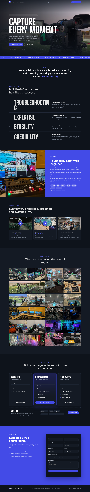

# netinfrasystems.com

Static rebuild of the Net Infra Systems site, served by nginx in a Docker container.



## Use the published image

Every push to `main` builds a multi-arch image (amd64 + arm64) and publishes it to GitHub Container Registry:

```bash
docker run -d --name netinfrasystems-site -p 8080:80 --restart unless-stopped \
  -e CONTACT_EMAIL="you@yourdomain.com" \
  ghcr.io/amurikurthy/netinfrasystemswebsite:latest
```

Tags: `latest` (main), `sha-<commit>`, and `X.Y.Z` when you push a `vX.Y.Z` git tag.

## Build it yourself

```bash
docker compose up -d --build
```

Then open http://localhost:8080. To run it without Compose:

```bash
docker build -t netinfrasystems-site .
docker run -d --name netinfrasystems-site -p 8080:80 --restart unless-stopped \
  -e CONTACT_EMAIL="you@yourdomain.com" \
  -e BOOKING_URL="https://calendly.com/your-link" \
  netinfrasystems-site
```

## Settings (environment variables, no rebuild needed)

| Variable        | What it does |
|-----------------|--------------|
| `CONTACT_EMAIL` | Shows "Prefer email?" on the page. If there's no `FORM_ENDPOINT`, the form opens the visitor's email app addressed here. |
| `BOOKING_URL`   | Shows a "Pick a time on our calendar" button (Calendly, Cal.com, Google appointment schedule, ...). |
| `FORM_ENDPOINT` | The form POSTs JSON here (Formspree, Basin, Getform or your own API). Its origin is added to the CSP automatically. |

If none are set, the form tells visitors that online requests aren't set up yet, so set at least one before going live.

## Layout

```
site/            HTML, CSS, JS, fonts (self-hosted), images (WebP)
docker/          nginx template + startup script that writes /config.js
Dockerfile       nginx:1.28-alpine; healthcheck on /healthz
```

The server sets gzip, cache headers, and a strict Content-Security-Policy. YouTube videos load from
youtube-nocookie.com only after a visitor clicks play.

## Going live

The container serves plain HTTP on port 80. Put it behind something that terminates TLS, e.g. Caddy,
Traefik, nginx-proxy + acme-companion, or a Cloudflare tunnel, then point the `netinfrasystems.com` and
`www` DNS records at that host (moving DNS away from Wix).
