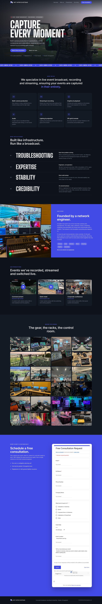
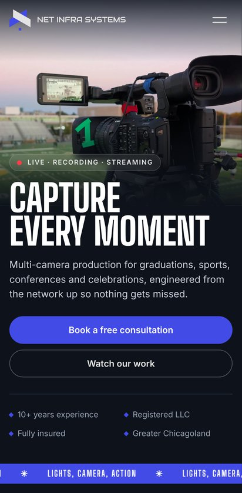

# netinfrasystems.com

The Net Infra Systems website: a static, single-page site served by nginx in a Docker container and
published through Pangolin.

<p>
  
  &nbsp;
  
</p>

The page has these sections, top to bottom (anchor in brackets):

- Hero
- What we do / services `#services`
- Why us `#why`
- Our story `#story`
- Productions `#work`
- Behind the scenes `#bts`
- Contact with the consultation form `#contact`

## Deploy with Docker Compose

The site runs behind Pangolin through a Newt tunnel, so no ports are exposed on the host.
`docker-compose.yml` in the repo root:

```yaml
name: netinfrasystemswebsite
services:
  netinfrasystemswebsite:
    image: ghcr.io/amurikurthy/netinfrasystemswebsite:latest
    container_name: netinfrasystemswebsite
    restart: unless-stopped

  netinfrasystemswebsite-newt:
    image: fosrl/newt
    container_name: netinfrasystemswebsite-newt
    restart: always
    environment:
      - PANGOLIN_ENDPOINT=https://pangolin.borderleaf.com
      - NEWT_ID=
      - NEWT_SECRET=
    extra_hosts:
      - "docker-host:host-gateway"

networks:
  default:
    name: netinfrasystemswebsite
```

1. Fill in `NEWT_ID` and `NEWT_SECRET` from the site you create in Pangolin.
2. Log in to GitHub's container registry. The image is private; see [Pulling the private image](#pulling-the-private-image).
3. Start it:

   ```bash
   docker compose up -d
   ```

4. In Pangolin, add a resource for `netinfrasystems.com` (and `www`) pointing at
   `http://netinfrasystemswebsite:80` on this site. Pangolin handles HTTPS.

The site is stateless, so there are no volumes to back up.

### Updating

Every push to `main` publishes a new image. To deploy it:

```bash
docker compose pull && docker compose up -d
```

Visitors see the update right away. Pages, CSS and JS are served with `Cache-Control: no-cache`:
browsers revalidate on each visit and get a `304` when nothing changed. Images and fonts are cached for 30 days, so
**if you replace an image, give the file a new name** (and update the reference) rather than overwriting it.

### Pulling the private image

`ghcr.io/amurikurthy/netinfrasystemswebsite` is private, so the host must be logged in to pull it.

1. Create a **classic** GitHub personal access token with only the `read:packages` scope.
2. On the host, log in. Run this as the same user that runs Docker, and paste the token at the password prompt so
   it stays out of your shell history and environment:

   ```bash
   docker login ghcr.io -u amurikurthy
   ```

3. Lock down the file Docker saved the login in:

   ```bash
   chmod 600 ~/.docker/config.json
   ```

The token is stored only in `~/.docker/config.json`. `docker logout ghcr.io` removes it; revoking the token on GitHub
disables it everywhere.

Alternatively, make the package public (GitHub profile → **Packages** → **netinfrasystemswebsite** →
**Package settings** → **Change visibility**). The image only contains the public website, and then no login is
needed.

### Testing locally without Pangolin

The compose file publishes no ports. For a quick local test, run the image directly and open http://localhost:8080:

```bash
docker run --rm -p 8080:80 ghcr.io/amurikurthy/netinfrasystemswebsite:latest
```

## Image and CI

`.github/workflows/docker-image.yml` builds on every push to `main`, on `v*` tags, and on pull requests. Pull
requests only build; they don't publish.

It does three things:

- Builds a multi-arch image (`linux/amd64`, `linux/arm64`).
- Publishes it to `ghcr.io/amurikurthy/netinfrasystemswebsite`.
- Smoke-tests the published image: `/healthz` must answer and the page must load.

Tags:

| Tag | When |
|---|---|
| `latest` | every push to `main` |
| `sha-<commit>` | every build |
| `X.Y.Z` | when you push a `vX.Y.Z` git tag |

The container serves on port 80, runs `nginx:1.28-alpine`, and has a Docker health check on `/healthz`.

To build locally instead:

```bash
docker build -t ghcr.io/amurikurthy/netinfrasystemswebsite:latest .
```

## Consultation form (Google Forms)

The contact section embeds the **Free Consultation Request** Google Form in an iframe (`#consultation-form` in
`site/index.html`). Responses land in Google Forms and its linked Sheet. Editing questions in Google Forms updates
the site automatically, with no deploy needed.

Settings the form relies on, so both sides get an email:

| Where in Google Forms | Setting | Why |
|---|---|---|
| Settings → Responses | **Collect email addresses: Responder input** | adds Google's own Email field (no sign-in required) |
| Settings → Responses | **Send responders a copy of their response: Always** | the client gets a confirmation email |
| Responses → ⋮ | **Get email notifications for new responses** | you get an email for each request |

Things to know:

- **Height:** the iframe can't size itself, because the form is on Google's domain. Its height is set per screen
  width in `site/css/styles.css` (`.form-embed iframe`: 1960px, or 2080/2120/2230px on narrow phones), measured so the
  form never scrolls inside its frame. If you add or remove several questions, adjust these numbers.
- **Security policy:** the Content-Security-Policy allows frames from `docs.google.com` and `*.google.com`. The
  second is needed because Google routes signed-in visitors through `accounts.google.com`; without it they see "This
  content is blocked".
- **Styling:** the form can't be restyled from this site (browsers block styling another site's page). Its theme
  colour is set in Google Forms to `#434BE7`, the site's indigo.
- **Fallback:** an "Open it in a new tab" link under the form covers browsers that block embedded content.

## Editing the site

Everything is plain HTML/CSS/JS in `site/`; there's no build step.

| To change | Edit |
|---|---|
| Text, services, sections | `site/index.html` |
| Production videos | the `data-yt="<YouTube video ID>"` attribute on each card in `site/index.html` |
| Gallery photos | `site/img/bts-NN.webp` (WebP, about 1400px on the long side) and the matching `<a>`/`` in the `#bts` gallery |
| Colours, spacing, layout | `site/css/styles.css`; colours are variables at the top (`--accent: #434be7`, `--bg: #0e131b`) |
| Mobile menu, video players, lightbox | `site/js/main.js` |

Videos load from `youtube-nocookie.com` only when a visitor clicks play. Fonts (Big Shoulders Display, Inter) are
self-hosted in `site/fonts/`. The site makes no other third-party requests and has no analytics or trackers.

## Server configuration

`docker/nginx.conf` sets up:

- gzip
- the caching rules above
- security headers: `Content-Security-Policy`, `X-Frame-Options`, `X-Content-Type-Options`, `Referrer-Policy`,
  `Permissions-Policy`
- the `/healthz` endpoint

The CSP only allows the site's own files, plus frames from YouTube (no-cookie) and Google (the form). Adding any other
outside service, such as analytics, a chat widget or another embed, means adding its domain to that policy, or the
browser will block it.

## Repository layout

```
site/                           the website: index.html, css/, js/, fonts/ (self-hosted), img/ (WebP + logos)
docker/nginx.conf               nginx config: caching, security headers, /healthz
Dockerfile                      nginx:1.28-alpine image with the site baked in
docker-compose.yml              deployment: site + Newt tunnel to Pangolin
.github/workflows/              build, publish and smoke-test the image
docs/                           README preview screenshots
```
